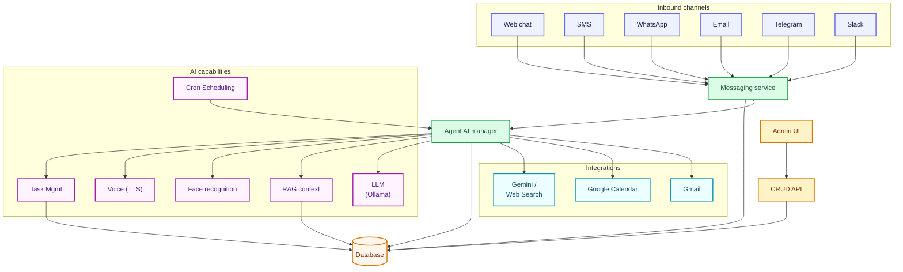

# Family Assistant

A fully local, privacy-preserving Family Assistant. A FastAPI + React
admin console captures your household's structured data (people,
relationships, goals, pets, residences, vehicles, insurance, finances,
documents, identity records) and a live AI assistant named **Avi** uses
that data — together with a local camera and local LLM — to recognize
family members by face, greet them by name, and answer questions with
full context about their goals, relationships, and belongings.

Nothing leaves the machine by default. Sensitive columns (SSNs, policy
numbers, account numbers, VINs, license plates) are encrypted at rest
with a Fernet key that only you hold. The only time data ever touches
the internet is the optional one-shot Gemini call that generates Avi's
avatar image.

## Overview

The project has three cooperating layers:

1. **Admin console** (`/admin/...`) — a React app for managing the
   family knowledge base. Every resource is full CRUD, with file uploads
   for photos and documents, and a live family-tree visualization on the
   dashboard. Admin API routes live under `/api/admin/*` so they can be
   guarded by a separate auth layer later.
2. **Live AI assistant** (`/aiassistant/:familyId`) — a standalone page
   that opens the webcam, runs **a two-stage face pipeline** (MediaPipe
   BlazeFace in the browser to detect *that there is a face*, then the
   backend's InsightFace + ArcFace recognizer only on brand-new face
   tracks to identify *who it is*), hands structured context ("who is
   in front of the camera, what are their goals, who are their
   siblings") to a local LLM, and streams the reply back into a chat
   panel. Recognized
   family members get an **instant spoken greeting** (no-LLM template
   → Kokoro-82M TTS, ~300 ms end-to-end) followed by a contextual
   LLM-generated follow-up question about their top goal — spoken out
   loud when the greeting finishes. A microphone toggle enables
   Web-Speech-API voice input, and a header speaker toggle mutes Avi.
   Avi himself is rendered on stage as the **Gemini-generated portrait**
   with a soft glow + sonar echo rings while speaking, an
   amplitude-driven SVG mouth overlay anchored to the portrait's
   detected landmarks, and a wave-and-smile on greet — no canvas, no
   WebGL, no proprietary runtime. (An earlier rigged Live2D experiment
   was removed; the simpler avatar reads the same emotionally and ships
   nothing but SVG.)
3. **Shared backend** (`/api/*`) — FastAPI on top of SQLAlchemy 2.0 and
   Postgres. The schema is intentionally verbose and self-describing:
   every table and column carries a Postgres `COMMENT`, and a read-only
   `llm_schema_catalog` view lets a local LLM discover the schema when
   generating dynamic SQL.

## Architecture Diagram

A bird's-eye view. Every family member — whether they're standing in
front of the camera, texting, emailing, or chatting on Telegram or
Slack —
lands on the same **messaging service**, which hands the conversation
to the **agent AI** to plan, call tools, and reply. Models all run
locally on the box; the only outbound traffic is to opt-in cloud APIs.



### Inbound surface matrix

| Surface | Trigger | Identity gate | Response path | Session row |
|---|---|---|---|---|
| **Live page** | `/api/aiassistant/chat` (SSE) or face match | family-scoped (single-machine trust) | streaming SSE deltas (+ optional fast-ack placeholder) | `live_sessions(source='live')`, idle 30 min |
| **SMS** | Twilio inbound webhook (signed) | `from` matches `people.mobile_phone_number` (E.164) | REST `Messages.create` reply via Twilio (empty TwiML on the webhook) | `live_sessions(source='sms', external_thread_id=<E.164>)`, never auto-closed |
| **WhatsApp** | Twilio inbound webhook (signed) — same `/api/sms/twilio/inbound` URL as SMS, dispatched on the `whatsapp:` prefix | `from` (after stripping `whatsapp:`) matches `people.{mobile,home,work}_phone_number` (E.164) | REST `Messages.create` with `From`/`To` `whatsapp:` prefixes via `TWILIO_WHATSAPP_SENDER_NUMBER` | `live_sessions(source='whatsapp', external_thread_id=<E.164>)`, never auto-closed |
| **Telegram** | bot long-poll, 25 s window | `message.from.id` ↔ `people.telegram_user_id` (or `@username`); unknowns get a one-tap "Share contact" prompt + SMS-2FA bind | `sendMessage` (+ optional fast-ack pre-message) | `live_sessions(source='telegram', external_thread_id=<chat_id>)` |
| **Slack** | Events API webhook (signed) at `/api/slack/events` — a DM to the Avi app or to Avi's own member account, or an @-mention in a channel | the sender's Slack account email matches `people.email_address` or a job's `work_email`; other workspaces and bot accounts are refused | `chat.postMessage` with the token of the identity that received the message; DMs inline, channel mentions in a thread | `live_sessions(source='slack', external_thread_id=<channel id>)` |
| **Email** | Gmail unread poll, 60 s | `From:` matches `people.email_address` | `users.messages.send` reply, threaded | `live_sessions(source='email', external_thread_id=<thread_id>)` |
| **Doorbird gate** | scaffold only (planned) | LAN device, no auth surface yet | open / ring | n/a |

### Sending files back

Ask Avi for a stored picture or document — "send me a picture of
Jackson's passport", "text me a photo of the BMW", "email me the dental
insurance card" — and it arrives with his reply, on the channel you
asked on. He can send the scan of an ID document, a saved document
(image or PDF), and the photo kept for a person, pet, vehicle or home.

| Channel | How the file travels | Limits |
|---|---|---|
| **Email** | attached to the reply | 20 MB per reply |
| **Slack** | uploaded into the same conversation or thread (needs the `files:write` scope) | 50 MB per file |
| **Telegram** | sent after the reply, pictures inline and everything else as a document | 45 MB per file |
| **WhatsApp** | Twilio fetches it from a signed link; one file per message | pictures and PDFs / Office files; pictures over 4 MB are shrunk |
| **SMS (MMS)** | Twilio fetches it from a signed link | pictures only; shrunk to under 1 MB so carriers deliver them |
| **Live page** | not supported — Avi suggests one of the channels above | |

**Who can be sent what.** The file only ever goes to the person who
asked, on the channel they asked on; Avi cannot send a household file
to anyone else. ID scans and documents filed under one person follow
the same rule as that person's ID numbers: the person, their spouse, or
their parent. Household documents and photos go to any identified
member of the household. Private files are not posted in a shared Slack
channel or Telegram group.

**How it works.** The agent calls the `send_file` tool
(`ai/tools/handlers/files.py`), which finds the record, applies the
rules above and the channel's limits, and returns an error the model
relays ("there's no picture saved for that license") instead of
approving. When the agent finishes, the channel's inbox service reads
the approved files for that turn (`services/outbound_files.py`) and
delivers them; if delivery fails, Avi says so in the conversation. The
transcript records which files went out (`attachments_sent` on the
reply's metadata).

**The signed link.** Twilio can't be handed a file, so for WhatsApp and
SMS the reply carries a URL under `/api/outbound-files/` on
`PUBLIC_BASE_URL`. That route needs no login. Each link is signed with a
key derived from `SESSION_SECRET_KEY`, names one file for one channel,
and stops working after `AI_FILE_LINK_TTL_SECONDS` (default 900).
Without a public https `PUBLIC_BASE_URL`, Avi declines to send files on
those two channels. Twilio keeps its own copy of any media it delivers,
in the account's message log.

### Rotating a stored image

A scan or phone photo that was saved sideways can be turned in the
admin console. Every stored picture has a **Rotate** control: the front
and back of an identity document, a document that is an image, a
person's profile picture and extra photos, pet and residence photos,
a vehicle's picture, and any photo attached to a vehicle or an
insurance policy. It opens a dialog with *Rotate left* and
*Rotate right*, a quarter turn each; nothing is stored until **Save**.

Save calls `POST /api/admin/images/rotate` (admins only) with what the
picture belongs to and the net clockwise turn (90, 180 or 270). The
server (`services/image_rotation.py`) writes the turned picture as a
new file, points the record at it, and deletes the old file. The new
path means no browser keeps showing the old picture.

- The picture is turned from how it is displayed. A phone photo's
  "held sideways" orientation note is applied first and then removed.
- The format is kept. PNGs keep their exact pixels. A JPEG is
  re-encoded once per save, at quality 95.
- PDFs, animated images and formats the server can't open (HEIC)
  are refused with a message, and left untouched.
- A person photo used for face recognition has its face data
  recomputed from the turned picture.

### Photos and PDFs on vehicles and insurance policies

A vehicle and an insurance policy can each carry any number of files:
photos or PDFs. Open the record for editing in the admin console.

- **Vehicles → edit a vehicle → Title and paperwork.** Each file is
  filed as *Title*, *Registration* or *Other*.
- **Insurance → edit a policy → Photos and documents.** Each file is
  filed as *Insurance card*, *Policy document* or *Other*.

Pick the kind, type an optional label ("Front", "2026 renewal"), and
choose one or more files. Each file shows as a card: click it to open
it in a new tab, change its kind from the menu on the card, turn a
sideways photo with **Rotate**, or **Remove** it. Files are saved
straight away; they don't wait for *Save changes*. A record has to be
saved once before files can be added to it.

- Admins only (`/api/admin/vehicles/{id}/attachments` and
  `/api/admin/insurance-policies/{id}/attachments`). A title or an
  insurance card shows the numbers the database otherwise encrypts.
- Photos (JPEG, PNG, HEIC, WebP, GIF, TIFF) and PDFs are accepted. The
  server decides by the file's contents, not its name. HEIC photos are
  stored but only preview in Safari and can't be rotated.
- Files live under `resources/family_<id>/vehicles/vehicle_<id>/documents/`
  and `resources/family_<id>/insurance/policy_<id>/`. Removing a file,
  or deleting the vehicle or policy, deletes them from disk.
- Avi can see in the database that these files exist (kind, label,
  file name) but can't yet open them or send them in a message.

### Request flow — "Avi, say hi to whoever walks in"

The face pipeline is **two-stage** to keep the backend free for chat
+ agent work. A lightweight **MediaPipe BlazeFace** detector runs
in the browser at ~4 Hz and only escalates to the heavyweight
backend recognizer when it sees a brand-new face track. Result:
when nobody is in front of the camera (or the same person has been
sitting there for an hour), the InsightFace + ArcFace path on the
Mac fires **zero** times instead of every 2.5 s.


## Key Technologies

### Backend · Python 3.12, `uv`-managed

| Category | Package | Why |
|---|---|---|
| Web framework | **FastAPI** · `uvicorn[standard]` | Async HTTP, automatic OpenAPI, SSE streaming, lifespan-managed background tasks |
| ORM + migrations | **SQLAlchemy 2.0** · **Alembic** | Typed mapped classes, first-class `COMMENT ON` support, forward-only revisions |
| Database driver | `psycopg2-binary` | Postgres |
| Validation | **Pydantic v2** · `pydantic-settings` | Request/response schemas + `.env` loading |
| Encryption | `cryptography` (Fernet) | AES-128-CBC + HMAC-SHA256 for sensitive columns |
| File uploads | `python-multipart` · Pillow | Photo + document ingest |
| HTTP client | **`httpx`** | Streaming Ollama, Gmail, Calendar, Twilio, Telegram, Slack, Doorbird |
| Face recognition | **InsightFace** · `onnxruntime` · OpenCV | ArcFace 512-d embeddings, CoreML provider on Apple Silicon |
| Text-to-speech | **kokoro-onnx** · `soundfile` · `espeakng-loader` | Kokoro-82M neural voices, 24 kHz mono WAV, ONNX Runtime (~330 MB weights) |
| Concurrency | `asyncio` · `concurrent.futures.ThreadPoolExecutor` | Long-poll inbox loops on the event loop, heavy agent runs on a bounded background pool |
| Image gen (optional) | `google-genai` | Avatar generation for Avi's profile image |
| Google APIs | `google-auth` · `google-auth-oauthlib` · raw REST via `httpx` | Gmail send/list/get + Calendar free/busy + OAuth refresh |
| SMS | Twilio REST + signed webhooks (validated in-process) | Two-way SMS as a chat surface, plus the second factor for Telegram contact verification |
| WhatsApp | Twilio Programmable Messaging WhatsApp Sender (REST + same signed webhook as SMS, dispatched on the `whatsapp:` prefix) | Two-way WhatsApp Business as a chat surface alongside SMS — same auth, dedup, and audit table |
| Telegram | Bot API over `httpx` (no python-telegram-bot dep) | `getUpdates` long-poll, `sendMessage`, `request_contact`, file download |
| Slack | Web API + Events API over `httpx` (no Slack SDK dep) | Signed event webhook, `chat.postMessage`, `users.info`, file download, `conversations.history` for catch-up |
| Door / gate | local `httpx` calls to a Doorbird IP | Open-gate intent (scaffold) |

### AI / agent layer

| Category | Component | Why |
|---|---|---|
| Heavy chat model | **`gemma4:26b`** via Ollama | Tool-using agent, multi-turn reasoning. Default for every surface. |
| Fast model | **`gemma4:e2b`** via Ollama (`/api/chat`, `think: false`) | 1-sentence contextual acknowledgments inside the 3-second race window so push surfaces never sit silent. |
| Agent loop | `ai/agent.py` | Plan/execute/observe loop, async generator that yields `task_started · step · delta · task_completed · task_failed` events to the SSE channel and writes one `agent_steps` row per emission. |
| Tool registry | `ai/tools.py` | Callable tools: `sql_query`, `lookup_person`, `reveal_sensitive_identifier`, `reveal_secret`, `send_file` (attach a stored photo or document to the reply), `gmail_send`, `calendar_list_upcoming`, `calendar_check_availability`, `calendar_find_free_slots`, `calendar_list_for_person`, `task_create / list / get / update / add_comment / add_follower / set_schedule / attach_link`, `web_search`, `telegram_invite`, plus `contacts_search` / `contacts_save` for the speaker's own address book, and the household-record writers: `household_records_list`, `goal_save`, `medication_save`, `identity_document_save`, `document_save_from_message`, `person_photo_save_from_message` and `household_record_save` (people, relationships, pets, vehicles, residences, insurance, financial accounts, medical conditions, physicians, jobs, websites, sensitive identifiers, document details, family settings — add / update only, no delete; email, phone and parent-role changes need a signed-in admin). Each is a `Tool(name, description, parameters, handler, timeout, requires)`. |
| Monitoring scheduler | `services/monitoring_scheduler.py` | Single-process `asyncio` loop launched in the FastAPI lifespan. Every `AI_MONITORING_TICK_SECONDS` it scans for `owner_kind='ai'` + `task_kind='monitoring'` rows whose `next_run_at` has elapsed, claims them under a row lock, advances `next_run_at` from the cron schedule (interpreted in `families.timezone`), and dispatches the run through the shared agent background pool. Monitoring runs use `AI_OLLAMA_THINKING_MODEL` with Ollama's `think:true` reasoning flag and have `web_search` available (Brave or Tavily, gated by `FA_SEARCH_PROVIDER`). |
| SQL sandbox | `ai/sql_tool.py` | Read-only Postgres role + statement-level guard; the model can write SELECTs against `llm_schema_catalog` without touching ciphertext. |
| Authz scope | `ai/authz.py` | Per-speaker access policy (self / spouse / parent / child / unauthorized) injected into every system prompt and re-checked inside sensitive tools. |
| RAG context | `ai/rag.py` · `ai/prompts.py` · `ai/schema_catalog.py` | Builds the household overview (people, goals, vehicles, residences, accounts) and the dynamic schema dump that lets the model write SQL on the fly. |
| Fast-ack | `ai/fast_ack.py` + `services/background_agent.py` | Surface-agnostic latency hider for the surfaces where the human is actively waiting. Telegram submits the heavy run to a shared `ThreadPoolExecutor` and calls `generate_contextual_ack_sync`; the live `/chat` SSE handler races the agent on the event loop with `generate_contextual_ack_async`. Either way, if the heavy model hasn't started replying after `AI_FAST_ACK_AFTER_SECONDS` (default 3 s), `gemma4:e2b` mints a one-sentence ack ("Looking up Sara's calendar.") that's delivered as a Telegram pre-message / SSE `fast_ack` event before the real reply. SMS, WhatsApp, and email deliberately skip fast-ack — carrier round-trips already mask the latency on the first two and an extra "thinking…" email would be noise on the third. |
| Inbox pollers | `services/email_inbox.py` · `services/telegram_inbox.py` | Long-poll loops started from FastAPI's `lifespan`. Each maintains its own dedup, audit-row writes, and per-thread `LiveSession`. |
| SMS / WhatsApp surface | `routers/sms_webhook.py` · `services/sms_inbox.py` · `integrations/twilio_sms.py` | Single Twilio inbound webhook (signature verified) handles **both** SMS and WhatsApp; the inbox service dispatches on `inbound.channel` (parsed from the `whatsapp:` prefix) for outbound sender, length cap, and live-session source. Audit rows share `sms_inbox_messages` distinguished by the `channel` column. |
| Slack surface | `routers/slack_webhook.py` · `services/slack_inbox.py` · `integrations/slack.py` | Slack Events API webhook (signature verified, no unsigned mode). Runs the same dedup → identity → session → instant ack → triage → agent → reply pipeline as SMS / WhatsApp / Telegram. Audit rows live in `slack_inbox_messages`. See [6b-3](#6b-3-slack). |

### Frontend avatar rendering

| Category | Package | Why |
|---|---|---|
| Avatar | Inline component `SpeakingMouth.tsx` over the Gemini-generated portrait | Lightweight, dependency-free animated avatar. Composites a soft glow + concentric "echo" rings over the portrait while Avi is speaking, an SVG mouth path morphed in real time by audio amplitude (closed → open → smiling, with a teeth hint on louder syllables), and a waving-hand emoji on greet. Mouth position is anchored to the InsightFace landmarks captured when the portrait was generated, falling back to "roughly 72 % down, 22 % wide" if no face was detected. We previously experimented with a rigged Live2D character (Pixi.js + Cubism 4) but pulled it: the basic SVG path looks just as alive, ships zero proprietary runtime, and works on every browser. |

### Frontend · Node, Vite

| Category | Package | Why |
|---|---|---|
| Build tool | **Vite** | Fast HMR, `/api` proxy in dev |
| Framework | **React 18** · **TypeScript** | Type-safe components |
| Routing | `react-router-dom` | `/admin/...` and `/aiassistant/...` roots |
| Data fetching | **@tanstack/react-query** | Cache, invalidation, optimistic UI |
| Forms | `react-hook-form` | Minimal-rerender form state |
| Styling | **Tailwind CSS** · shadcn-style components | Utility-first UI |
| Icons | `lucide-react` | Consistent icon set |
| In-browser face detection | **`@mediapipe/tasks-vision`** (BlazeFace short-range) | First-pass face/figure detection at ~4 Hz, ~225 KB tflite + 2 MB WASM, runs entirely client-side. Gates the backend's heavyweight InsightFace recognizer so it only fires on new face *tracks* (someone walks in), not every 2.5 s. WASM + model are mirrored into `ui/react/public/mediapipe/` by `scripts/copy-mediapipe-assets.mjs` (`postinstall` hook); see `src/lib/localFaceWatcher.ts`. |

### Local AI daemons

| | |
|---|---|
| **Ollama** | Serves both LLMs on `localhost:11434`. Heavy model `AI_OLLAMA_MODEL` (default `gemma4:26b`) drives the agent; lightweight `AI_OLLAMA_FAST_MODEL` (default `gemma4:e2b`) generates fast acks and other structured one-shots. Ollama serializes per-loaded-model unless `OLLAMA_NUM_PARALLEL>1`; idle models unload after 5 min by default (`keep_alive`). |
| **InsightFace (buffalo_l)** | Face detection + 512-d ArcFace embeddings. First run downloads ~300 MB into `~/.insightface/`. Uses CoreML provider when `AI_MAC_STUDIO_OPTIMIZED=true` (default). |
| **Kokoro-82M (kokoro-onnx)** | Neural text-to-speech for Avi's spoken greetings + follow-up questions. Weights (~330 MB total: `kokoro-v1.0.onnx` + `voices-v1.0.bin`) are lazy-downloaded on first `/api/aiassistant/tts` call into `resources/models/kokoro/`. Cached synthesis results live in `resources/family/tts_cache/` so repeat phrases return in ~8 ms. Voice is picked from the assistant's `gender` (female → `af_bella`, male → `am_adam`) or forced via `AI_TTS_VOICE`. |

## Running

Once dependencies are installed and migrations applied, the app runs as
two processes plus the Ollama daemon. The managed scripts under
`scripts/` take care of PID tracking, log files, and health probes so
you don't have to juggle three terminals.

| Service | URL | Managed by |
|---|---|---|
| Backend API | <http://localhost:8000> (docs at `/docs`) | `scripts/start.sh` → `.run/backend.pid` |
| Frontend dev server | <http://localhost:5173> | `scripts/start.sh` → `.run/frontend.pid` |
| Ollama daemon | <http://localhost:11434> | managed separately (`ollama serve`) |

### Managed scripts

All scripts live in `scripts/`, print timestamped output, and store
state under `.run/` (PIDs) and `logs/` (stdout + stderr). Both
directories are git-ignored.

```bash
scripts/deploy.sh                # one-shot: uv sync + npm install + alembic upgrade
scripts/deploy.sh --build        # also produce a production frontend bundle
scripts/deploy.sh --clean        # wipe .venv and node_modules first

scripts/start.sh                 # start backend + frontend (waits for health)
scripts/start.sh backend         # start just one service
scripts/start.sh --force         # kill orphans on :8000/:5173 before starting

scripts/stop.sh                  # graceful SIGTERM (then SIGKILL fallback)
scripts/stop.sh --force          # also sweep anything still bound to the ports

scripts/restart.sh               # stop --force + start
scripts/restart.sh backend       # restart a single service

tail -f logs/backend.log logs/frontend.log
```

Typical daily flow: `scripts/start.sh` in the morning, `scripts/restart.sh`
after pulling new commits, `scripts/stop.sh` at end of day. The sidebar's
purple "Live AI Assistant" button jumps straight to
`/aiassistant/:familyId` for the currently-selected family.

### Stopping background services (rarely needed)

```bash
scripts/stop.sh --force                 # app services only
brew services stop postgresql@16        # fully stop Postgres
pkill -f 'ollama serve'                 # fully stop Ollama
```

## Syncing

After pulling new commits, refresh every layer so schema + deps match:

```bash
git pull

# 1. Python deps (adds/removes/updates packages per pyproject.toml)
uv sync

# 2. Node deps
cd ui/react && npm install && cd -

# 3. Database schema (forward-only; safe to run repeatedly)
uv run alembic upgrade head

# 4. Face embeddings for newly uploaded photos enroll automatically via a
#    background task (see step 8 of Initial Setup). Run this only if you
#    imported photos directly into the DB or want to force a full
#    re-enroll of every flagged photo that's missing an embedding.
# curl -s -X POST 'http://localhost:8000/api/aiassistant/face/enroll?family_id=1'
```

If the backend was already running, restart it so freshly added routers
and config changes are picked up (Uvicorn's `--reload` sometimes misses
new modules):

```bash
lsof -ti :8000 | xargs -r kill -9
uv run uvicorn api.main:app --app-dir python --reload
```

## Installing Dependencies

Day-to-day dependency management:

```bash
# ── Python ───────────────────────────────────────────────
# add a runtime dep
uv add some-package

# add a dev-only dep
uv add --group dev some-tool

# remove a dep
uv remove some-package

# sync your environment to pyproject.toml exactly
uv sync

# ── Node (frontend) ──────────────────────────────────────
cd ui/react
npm install some-package                 # runtime
npm install --save-dev some-tool         # dev-only
npm uninstall some-package
```

### Optional: pull the local LLM

```bash
# default expected model (matches AI_OLLAMA_MODEL in .env)
ollama pull gemma4

# or a specific size/tag
ollama pull gemma3:27b
```

Pick something that fits your RAM. On an M-series Mac, `gemma3:4b` is a
good daily driver; `gemma3:27b` or larger shines on a Mac Studio.

## Initial Setup

Run these one-time steps on a fresh clone.

### 1. Command-line tools

```bash
xcode-select --install
```

### 2. Python (backend) — `uv`

```bash
brew install uv
uv python pin 3.12
uv sync
```

### 3. Postgres

```bash
brew install postgresql@16
brew services start postgresql@16

# one-time role + database
createuser -s family_assistant
createdb -O family_assistant family_assistant
psql -d family_assistant -c "ALTER USER family_assistant WITH PASSWORD 'Avi123!';"
```

Connection settings live in `.env` as `FA_DB_HOST`, `FA_DB_PORT`,
`FA_DB_USER`, `FA_DB_PWD`, `FA_DB_NAME`.

### 4. Node (frontend)

```bash
brew install node
cd ui/react && npm install
```

### 5. Ollama + local LLM

```bash
brew install ollama
ollama serve &                   # starts the daemon
ollama pull gemma4               # or gemma3, gemma3:27b, etc.
```

### 6. Configure secrets in `.env`

Generate a Fernet key for encrypting sensitive columns:

```bash
uv run python -c "from cryptography.fernet import Fernet; print(Fernet.generate_key().decode())"
```

Paste it into `.env` as `FA_ENCRYPTION_KEY`. **Never commit `.env`.** If
you lose the key you will not be able to decrypt existing SSNs, policy
numbers, VINs, or account numbers.

Example `.env` layout:

```ini
FA_DB_HOST=localhost
FA_DB_PORT=5432
FA_DB_USER=family_assistant
FA_DB_PWD=Avi123!
FA_DB_NAME=family_assistant
FA_ENCRYPTION_KEY=<paste-generated-fernet-key-here>
FA_STORAGE_ROOT=./resources/family
FA_CORS_ORIGINS=http://localhost:5173

# Optional: Gemini avatar generation for the assistant profile image
GEMINI_API_KEY=
GEMINI_PROJECT_ID=

# Local AI assistant (Avi)
AI_OLLAMA_HOST=http://localhost:11434
AI_OLLAMA_MODEL=gemma4:26b
# Optional: separate, beefier model used for Avi's monitoring runs
# (deep-thinking research). Defaults to AI_OLLAMA_MODEL when unset.
AI_OLLAMA_THINKING_MODEL=
AI_OLLAMA_THINKING_ENABLED=true
AI_FACE_MATCH_THRESHOLD=0.40
AI_MAC_STUDIO_OPTIMIZED=true

# AI monitoring scheduler (owner_kind=ai + task_kind=monitoring)
AI_MONITORING_ENABLED=true
AI_MONITORING_TICK_SECONDS=30
AI_MONITORING_DEFAULT_CRON=0 9 * * *      # daily at 09:00 family-tz
AI_MONITORING_RUN_TIMEOUT_SECONDS=600

# Web search for monitoring runs.
#   "gemini" (default) — uses GEMINI_API_KEY above + Gemini's
#                        google_search tool grounding; returns a
#                        synthesised, citation-backed answer that
#                        the local Gemma then re-reads with family
#                        context to produce the task comment.
#   "brave"  — classic SERP API (free tier 2k/mo); set BRAVE_SEARCH_API_KEY.
#   "tavily" — AI-tuned SERP w/ page extracts;       set TAVILY_API_KEY.
#   ""       — disable web search entirely.
FA_SEARCH_PROVIDER=gemini
BRAVE_SEARCH_API_KEY=
TAVILY_API_KEY=
AI_WEB_SEARCH_DEFAULT_LIMIT=5

# Text-to-speech (Kokoro-82M). First `/tts` call lazy-downloads ~330 MB.
AI_TTS_ENABLED=true
AI_TTS_ENGINE=kokoro
# "auto" lets the assistant's gender pick the voice pack. Override
# with any Kokoro voice name (af_bella, af_nicole, am_adam, bm_lewis, ...).
AI_TTS_VOICE=auto
AI_TTS_SPEED=1.0
AI_TTS_MODEL_DIR=./resources/models/kokoro
```

### 6b. Google OAuth (Avi's Gmail + Calendar)

This is optional but unlocks two big things for Avi: sending email
from his own Gmail address, and reading any calendar shared with him
(including yours, for free/busy lookups). It works entirely on
`http://localhost` — no public domain, no tunnel, no app verification.

1. **Create the Google account Avi will use.** A regular gmail.com
   address is fine. You can also use a Google Workspace address.

2. **Spin up a Google Cloud project** (one-time, free tier is enough):
   - Go to <https://console.cloud.google.com/> → create a new project,
     e.g. `family-assistant`.
   - **APIs & Services → Library** → enable **Gmail API** and
     **Google Calendar API**.

3. **Configure the OAuth consent screen:**
   - **APIs & Services → OAuth consent screen** → User type =
     **External**.
   - App name = `Family Assistant (local)`, user support email = you.
   - **Scopes:** add `gmail.send` and `calendar.readonly` (the rest —
     `openid`, `email`, `profile` — are non-sensitive and are added
     automatically).
   - **Test users:** add Avi's gmail and your own. While the app is
     in "Testing" mode (the default) only listed test users can log in,
     and you don't need Google's app review.

4. **Create the OAuth client:**
   - **APIs & Services → Credentials → Create credentials → OAuth
     client ID**.
   - Application type = **Web application**.
   - Authorized redirect URIs: add exactly
     `http://localhost:8000/api/admin/google/oauth/callback`.
   - Save and copy the client id + client secret into `.env`:

   ```ini
   GOOGLE_OAUTH_CLIENT_ID=<paste here>.apps.googleusercontent.com
   GOOGLE_OAUTH_CLIENT_SECRET=<paste here>
   GOOGLE_OAUTH_REDIRECT_URI=http://localhost:8000/api/admin/google/oauth/callback
   GOOGLE_OAUTH_POST_LOGIN_REDIRECT=http://localhost:5173/admin
   ```

5. **Restart the API** (`./start-services.sh`) and open the admin
   console → **Assistant** page. The "Google account" card shows a
   **Connect with Google** button. Click it, sign in as Avi, and
   approve the scopes. You'll land back on the admin page with a
   green confirmation toast.

6. **Test it.** The same card has two smoke-test buttons:
   - **Send test email to self** — proves the Gmail scope works.
   - **Show next 72h of events** — proves the Calendar scope works.

7. **Share your personal calendar with Avi** so he can see your
   schedule:
   <https://calendar.google.com/> → your calendar → Settings → Share
   with specific people → add Avi's gmail with permission **See all
   event details** (or **Free/busy** if you don't want titles
   exposed). Avi will then see your events alongside his own when he
   queries the calendar.

**How Avi answers a calendar question.** Every per-person calendar
tool works through the same three steps:

1. *Who is it about?* The person asking ("am I free…", "my week") or
   the family member they name. A name that fits two people is asked
   about, not guessed.
2. *Which calendars are theirs, and what can Avi see?* The person's
   **email address** is their personal calendar; the **work email** on
   each entry under **Jobs** on their profile is a work calendar. Each
   one is read as *event details*, *busy times only* (shared as
   Free/busy — fine for availability, no titles) or *not shared*.
3. *What does it add up to?* Busy time is merged across the calendars
   Avi can see. For a range longer than a day it is totalled per date,
   so "which day am I most free next week?" is answered from those
   totals, with the date. If a calendar isn't shared, the reply says
   the answer is incomplete.

"This week" and "next week" are given to the model as dates, in the
family's timezone. Weeks start on Sunday; set `WEEK_STARTS_ON=monday`
in `.env` to change that.

Tokens are stored Fernet-encrypted in the
`google_oauth_credentials` table. Refresh tokens never leave the
server, and the only plaintext columns are the granted email,
scopes, and access-token expiry (kept plain so the admin UI can
render a status badge without decryption).

**Important — token lifetime.** Google issues two tokens: an
**access_token** (1-hour TTL — what the UI shows under "Access
token rotates") and a long-lived **refresh_token** (used silently
to mint new access tokens before each call, so you never see the
1-hour rotation). For sensitive scopes like `gmail.send` and
`calendar.readonly`, **the refresh_token's lifetime depends on
your OAuth consent screen publishing status**:

| Status | Refresh token lifetime |
| --- | --- |
| **Testing** (default) | **7 days** — you'll have to reconnect each week |
| **In production**, unverified | Indefinite (until revoked or 6 months idle) |
| **In production**, verified | Indefinite |

For a local personal tool, **publish the app to Production** to
escape the 7-day cap. You don't need to complete Google's
verification process — Google only blocks *third-party* users from
unverified apps; the app owner can always click "Advanced → Go to
(unsafe)" past the warning. Steps:

1. Visit <https://console.cloud.google.com/apis/credentials/consent>
2. In the "Publishing status" card click **Publish App** → confirm.
3. Disconnect + reconnect from the admin UI. The new refresh token
   issued under Production status is good indefinitely.

### 6b-2. Contacts (each person's own address book)

Avi can add people to a family member's contacts, or update the entry
that is already there, from whatever they send him:

- a **forwarded email** ("sync this person to my contacts") — he uses
  the original sender's address and their signature block;
- a **shared contact card** (Telegram contact, or a `.vcf` attachment
  on WhatsApp / SMS / email);
- a **photo of a business card**;
- details **pasted or typed** into any chat.

He looks for name, company, role, email and phone, preferring a mobile
number when one is given. Before saving he checks the address book for
the same email, then the same phone number, then the same name:

| Finds | Does |
| --- | --- |
| one entry with that email or phone | updates it — adds what's new, never removes anything |
| nothing | creates a new contact |
| only a name match, or several possible matches | saves nothing and asks which one is meant |

**Whose contacts?** The person asking. Avi's Gmail/Calendar connection
above belongs to *Avi's* Google account, so it can't reach anyone's
address book. Each family member separately lets Avi into **their own**
Google Contacts; "add her to my contacts" from Ben goes to Ben's, the
same message from Sarah goes to Sarah's. Nobody can read or write
another person's contacts through Avi.

One-time setup, in the same Google Cloud project as 6b:

1. **APIs & Services → Library** → enable **People API**.
2. **OAuth consent screen → Scopes** → add
   `https://www.googleapis.com/auth/contacts`. If the app is still in
   Testing, add each family member's Google address under **Test
   users**.
3. **Credentials → your OAuth client → Authorized redirect URIs** →
   add `<PUBLIC_BASE_URL>/api/contacts/google/oauth/callback` — for
   example `https://your-name.ngrok.app/api/contacts/google/oauth/callback`,
   or `http://localhost:8000/api/contacts/google/oauth/callback` for a
   purely local setup. The Contacts card shows the exact address when
   Google sign-in isn't configured; set
   `GOOGLE_CONTACTS_OAUTH_REDIRECT_URI` to use a different one.
4. Apply the migration (`uv run alembic upgrade head`, or
   `scripts/restart.sh`).

Then connect, either way:

- **Admin console → People → a person → Contacts card → Connect Google
  Contacts.** Sign in with *that person's* Google account.
- **Just ask Avi.** If someone asks him to save a contact before
  they've connected, he replies with a personal link. It requires
  signing in to the family site as that person, so a forwarded link is
  no use to anyone else.

Google's consent screen words this permission as "See, edit, download,
and permanently delete your contacts" — it has only one read-and-write
contacts scope. Avi only looks contacts up, adds them and edits them;
there is no delete in the code. The grant is stored Fernet-encrypted in
`contact_provider_connections`, is separate from Avi's Gmail token, and
can be removed from the same card (or at
<https://myaccount.google.com/permissions>). The 7-day Testing-mode
token lifetime described above applies here too.

`CONTACTS_DEFAULT_PROVIDER` (default `google`) picks the address book
Avi uses. The provider interface lives in
`python/api/integrations/contacts/`; `apple.py` is a placeholder for
iCloud Contacts that reports "not supported yet".

### 6b-3. Slack

Family members can talk to Avi in a Slack workspace exactly as they do
over SMS or WhatsApp: questions, requests, photos and documents, and
follow-ups in the same conversation. It is the same agent, tools,
household context and privacy rules — Slack is only another way in.

**Two ways to reach him, both work:**

- **Message the Avi app** (Apps → Avi in the Slack sidebar), or
  @-mention it in a channel it has been added to.
- **Message Avi's own member account**, like messaging a person.

The reply always comes back from whichever of the two you wrote to. A
direct message is answered inline; a message in a thread is answered in
that thread; a channel mention is answered in a thread under it. In a
channel Avi only responds when mentioned, and he is told that everyone
there can read his answer.

**Who gets an answer.** Avi looks up the sender's Slack account and
matches its email to a person's email address (or the work email on one
of their jobs) — so a family member must have joined Slack with an
address that is on their record. Anyone else gets no reply at all and
is logged as `ignored_unknown_sender`. Accounts from another workspace
(Slack Connect guests) and bot accounts are refused even if the email
matches. Avi never answers his own messages, edits, deletions or other
apps' posts.

**Slack app settings** (<https://api.slack.com/apps> → your app):

1. **Socket Mode** → off. Events are delivered over HTTP.
2. **Event Subscriptions** → on. Request URL:
   `<PUBLIC_BASE_URL>/api/slack/events` (e.g.
   `https://your-name.ngrok.app/api/slack/events`). The backend must be
   running for Slack to mark it Verified.
   - *Subscribe to bot events*: `message.im`, `app_mention`.
   - *Subscribe to events on behalf of users*: `message.im` (this is
     what delivers DMs sent to Avi's member account). To have Avi's
     member account answer @-mentions in channels too, also add
     `message.groups` (private channels), `message.channels` (public
     channels) and `message.mpim` (group DMs).
3. **OAuth & Permissions**
   - *Bot token scopes*: `chat:write`, `im:history`, `app_mentions:read`,
     `users:read`, `users:read.email`, `files:read`, `files:write`.
   - *User token scopes* (authorise while signed in to Slack **as Avi**):
     `chat:write`, `im:history`, `files:read`, `files:write` — plus `groups:history`,
     `channels:history` and `mpim:history` if you added the channel
     events above (Slack adds them for you when you subscribe).
   - Reinstall the app to the workspace after changing scopes, and copy
     the tokens into `.env` again if Slack shows new ones.
4. **App Home** → Messages Tab on, and tick "Allow users to send Slash
   commands and messages from the messages tab".

**Channels.** The Avi app only hears a mention in a channel it is a
member of — type `/invite @<app name>` there once. Avi's member account
hears mentions in the channels it has joined, provided the channel
events above are subscribed; with those, Slack sends every message from
those channels to this server, and anything that doesn't mention Avi is
dropped without being stored.

`files:read` is what lets Avi open photos and documents. Without it he
still answers, and says he couldn't open the file. `files:write` is what
lets him send one back (see [Sending files back](#sending-files-back));
without it he says the file couldn't be attached.

**`.env`:**

```bash
SLACK_APP_SIGNING_SECRET=...   # Basic Information → Signing Secret. Required: without it every event is refused.
SLACK_BOT_TOKEN=xoxb-...       # the Avi app
SLACK_USER_TOKEN=xoxp-...      # Avi's own member account (optional; omit to use the app only)
SLACK_APP_ID=A...              # optional; events for any other app are dropped
# AI_SLACK_INBOUND_ENABLED=true   # false = record messages but don't answer
# AI_SLACK_REPLY_MAX_CHARS=3000
```

Then apply the migration and restart (`scripts/restart.sh`). The
**Status** page has a Slack row that checks both tokens. It cannot see
Slack's Event Subscriptions page, so a green row does not prove the
Request URL is set.

**If the server was down.** Slack retries a failed delivery for a few
minutes and then gives up. On startup (and in
`scripts/recover_inbound.py`) Avi re-reads the last
`AI_INBOUND_RECOVERY_SMS_LOOKBACK_HOURS` of every direct message
conversation a family member already has with him and answers anything
he has no record of. Channel mentions missed during an outage are not
replayed.

**Not included.** Avi only replies on Slack; reminders, monitoring
results and delivery fallbacks still go out by the existing channels.

### 6c. Authentication (browser sign-in)

The HTTP surface is **locked down** behind Google sign-in. Anonymous
visitors only see the marketing landing page and the legal docs;
everything under `/admin/*`, `/aiassistant/*`, and the entire JSON API
requires a valid session cookie. Two roles:

| Role | Source of truth | What they can do |
| --- | --- | --- |
| **Admin** | Email is in `ADMIN_EMAILS` (comma-separated, lowercased) | Full CRUD across every family — same UI you've always used |
| **Family member** | Email matches a `people.email_address` row (case-insensitive) and is *not* in `ADMIN_EMAILS` | Read-only Overview for their family, the Live AI page, their session history, and the Tasks board filtered to ones they created / are assigned to / follow |

Anyone whose email is on neither list gets bounced from the OAuth
callback with a friendly "this account is not authorised" message; the
session cookie is never minted.

**Setup steps** (the secrets section in `.env` already has placeholders;
fill them in once):

1. **Add the admin emails** to `.env`:

   ```ini
   ADMIN_EMAILS="you@gmail.com,partner@gmail.com"
   ```

2. **Generate a session signing key.** Treat it like
   `FA_ENCRYPTION_KEY` — never commit, rotate to log everyone out:

   ```bash
   python -c "import secrets; print(secrets.token_urlsafe(48))"
   ```

   Paste into `.env` as `SESSION_SECRET_KEY`.

3. **Create a SECOND Google OAuth client** specifically for browser
   logins. The one from §6b belongs to *Avi* (Gmail + Calendar
   scopes) — never reuse it for human sign-in. At
   <https://console.cloud.google.com/apis/credentials> →
   *Create credentials → OAuth client ID*:
   - Application type = **Web application**
   - Name = e.g. `Family Assistant Login`
   - Authorized redirect URIs (add **both** so localhost dev and the
     public ngrok tunnel both work):
     - `http://localhost:8000/api/auth/google/callback`
     - `https://avi-maisano.ngrok.app/api/auth/google/callback`
   - Scopes are the non-sensitive trio (`openid email profile`) so
     no Google verification review is required — the consent screen
     stays usable in "Testing" mode forever for these scopes.

   Copy the credentials into `.env`:

   ```ini
   USER_LOGIN_GOOGLE_CLIENT_ID=<paste>.apps.googleusercontent.com
   USER_LOGIN_GOOGLE_CLIENT_SECRET=<paste>
   USER_LOGIN_GOOGLE_REDIRECT_URI=http://localhost:8000/api/auth/google/callback
   PUBLIC_BASE_URL=https://avi-maisano.ngrok.app
   ```

   `PUBLIC_BASE_URL` is the canonical origin the SPA is served from.
   The cookie's `Secure` flag is set automatically when it starts
   with `https://` (so localhost dev over plain http still works
   while the ngrok-served deployment gets the Secure flag).

4. **Add a family member.** Open **People** → either edit an existing
   row or create a new one and put their personal Gmail in
   `email_address`. That's the entire opt-in: as soon as the row
   exists, that email can sign in and lands on their family's
   read-only Overview. Removing the email (or deleting the row) revokes
   their access on the next request — identity is derived live, no
   user table to keep in sync.

5. **Restart the API** so the new env vars take effect, then visit
   <http://localhost:5173/login>. Click *Sign in with Google* and
   you'll be redirected back to your role-appropriate landing page
   (admins → families list; members → their family Overview).

**Public allowlist.** These routes deliberately stay open so external
systems can hit them without a cookie: `/`, `/legal/*`, `/api/health`,
`/api/auth/*`, `/api/sms/twilio/inbound` (Twilio's own signature is
the gate), `/api/admin/google/oauth/callback` (Avi's Gmail/Calendar
callback — Google has to be able to reach it) and
`/api/contacts/google/oauth/callback` (the per-person contacts
callback; it only accepts the single-use `state` issued to a signed-in
user). Everything else returns
401 unless a valid `fa_session` cookie is presented.

### 7. Run database migrations

```bash
uv run alembic upgrade head
```

This creates every table and a read-only `llm_schema_catalog` view that
exposes each table/column along with its natural-language description.
A local LLM can `SELECT * FROM llm_schema_catalog` to discover the
schema when generating dynamic SQL.

### 8. Enroll faces (usually automatic)

Uploading a photo through the admin console with **"Use for face
recognition"** ticked **automatically schedules a background task** that
extracts an InsightFace embedding and writes it to `face_embeddings`.
The same is true for toggling the flag on/off on an existing photo, and
cascade-deletes take care of cleanup when a photo is removed. You
usually don't need to do anything — the Live AI page's face-status
badge will tick up from "N faces" to "N+1 faces" a few seconds after
the upload.

For bulk backfill (e.g. after importing photos straight into the
database, or on a fresh install where the InsightFace model pack needs
to download), kick off a one-shot full-family enrollment pass:

```bash
curl -s -X POST 'http://localhost:8000/api/aiassistant/face/enroll?family_id=1'
```

That walks every flagged photo that doesn't already have an embedding
and processes them in a single request.

### 9. Warm up the voice (optional, first run only)

The first `POST /api/aiassistant/tts` call downloads the Kokoro-82M
ONNX weights + voice pack (~330 MB) into `resources/models/kokoro/`
and initializes the inference session. Everything after is cached;
identical phrases re-play in ~8 ms and fresh syntheses land in ~300 ms
on an M-series Mac. To pre-warm so a family member doesn't stare at a
silent greeting on your very first camera test:

```bash
curl -s -X POST http://localhost:8000/api/aiassistant/tts \
  -H 'Content-Type: application/json' \
  -d '{"text":"Hello, I am Avi."}' \
  --output /tmp/hello.wav
afplay /tmp/hello.wav   # macOS
```

---

## Data model (LLM-friendly)

Table and column names are **verbose natural-language snake_case**, and
every table/column has a Postgres `COMMENT` describing what it holds.
This makes dynamic SQL generation by a local LLM reliable — the LLM can
read `llm_schema_catalog` and see things like:

- `people.primary_family_relationship` — "spouse, child, parent, …"
  (convenience label — the authoritative tree lives in
  `person_relationships`).
- `person_relationships.relationship_type` — atomic edges: `parent_of`
  (directional) and `spouse_of` (symmetric); siblings/cousins/etc. are
  derived.
- `person_photos.use_for_face_recognition` — flags which photos Avi
  should use for enrollment.
- `goals.priority` — `urgent · semi_urgent · normal · low`; surfaced in
  every RAG prompt so Avi can ask specific, fresh follow-up questions.
- `insurance_policies.policy_type` — `auto, home, renters, health, …`.
- `vehicles.registration_expiration_date` — "Used by Avi to proactively
  warn …".

For a complete table-by-table walkthrough — including the AI surfaces
(`live_sessions`, `agent_tasks`, the inbox-message audit tables, the
Telegram invite + verification tables, etc.) and an ER-style diagram of
how the pieces hang together — see **[`docs/DATA_MODEL.md`](docs/DATA_MODEL.md)**.

Tables today, grouped by domain:

- **Family core** — `families`, `assistants`, `people`,
  `person_relationships`, `person_photos`, `face_embeddings`, `goals`.
- **Health** — `medical_conditions`, `medications`, `physicians`.
- **Household assets** — `pets`, `pet_photos`, `residences`,
  `residence_photos`, `addresses`, `vehicles`, `vehicle_attachments`,
  `insurance_policies`, `insurance_policy_people`,
  `insurance_policy_vehicles`, `insurance_policy_attachments`,
  `financial_accounts`, `documents`.
- **Identity (encrypted)** — `identity_documents`,
  `sensitive_identifiers`.
- **AI conversation surfaces** — `live_sessions`,
  `live_session_participants`, `live_session_messages`.
- **Inbox audit** — `email_inbox_messages`, `sms_inbox_messages`,
  `sms_inbox_attachments`, `telegram_inbox_messages`,
  `telegram_inbox_attachments`, `slack_inbox_messages`,
  `slack_inbox_attachments`.
- **Telegram onboarding** — `telegram_invites` (deep-link claims),
  `telegram_contact_verifications` (SMS-2FA for contact-share linking).
- **Tasks (kanban + monitoring)** — `tasks` (carries `owner_kind` ∈
  `{human, ai}`, `task_kind` ∈ `{todo, monitoring}`, plus
  `cron_schedule` / `next_run_at` / `last_run_*` /
  `monitoring_paused` for AI-owned standing jobs), `task_comments`,
  `task_followers`, `task_attachments`, `task_links` (URL citations
  added by Avi during monitoring runs).
- **Agent audit** — `agent_tasks`, `agent_steps`.
- **External-service credentials** — `google_oauth_credentials`
  (Fernet-encrypted refresh tokens for Gmail + Calendar),
  `contact_provider_connections` (each person's own address-book
  grant, also Fernet-encrypted).

## Encryption of sensitive columns

- Sensitive values (SSN, policy numbers, account/routing numbers, VINs,
  license plates, ID document numbers) are encrypted at the application
  layer with **Fernet** (AES-128-CBC + HMAC-SHA256) using
  `FA_ENCRYPTION_KEY`.
- Ciphertext is stored in `*_encrypted` `bytea` columns. The plaintext
  is **never** logged, returned from the API, or usable from SQL.
- For display and for LLM-generated SQL filters we keep a paired
  plaintext `*_last_four` column (e.g. `policy_number_last_four`,
  `account_number_last_four`). The LLM writes queries like
  `WHERE policy_number_last_four = '1234'` without ever touching
  ciphertext.

## Repository layout

```
family-assistant/
├── python/api/                    FastAPI backend
│   ├── main.py                    route mounting + lifespan (email + telegram pollers)
│   ├── config.py                  pydantic-settings (DB, Fernet, Ollama, Twilio, Telegram, face/TTS, fast-ack)
│   ├── db.py                      SQLAlchemy 2.0 engine + session
│   ├── crypto.py                  Fernet helpers
│   ├── storage.py                 filesystem uploads under resources/family/<family_id>/...
│   ├── utils/                     phone normalisation, etc.
│   ├── models/                    one ORM class per table, every column has comment=
│   ├── schemas/                   Pydantic request/response shapes (never expose ciphertext)
│   ├── routers/                   one FastAPI router per resource
│   │   ├── families · people · person_photos · person_relationships
│   │   ├── goals · medical_conditions · medications · physicians
│   │   ├── pets · pet_photos · residences · residence_photos · addresses
│   │   ├── vehicles · insurance_policies · financial_accounts · documents
│   │   ├── record_attachments     (photos + PDFs on vehicles and policies)
│   │   ├── identity_documents · sensitive_identifiers · assistants
│   │   ├── tasks · google · contacts · status · legal · media
│   │   ├── ai_chat · ai_face · ai_tts · live_sessions · agent_tasks
│   │   ├── sms_webhook            (public Twilio inbound)
│   │   └── slack_webhook          (public Slack Events API inbound)
│   ├── ai/
│   │   ├── agent.py               plan/execute/observe loop, SSE event stream
│   │   ├── tools.py               16 callable tools (SQL, calendar, email, tasks, ...)
│   │   ├── sql_tool.py            sandboxed read-only SQL
│   │   ├── authz.py               per-speaker scope + sensitive-tool guard
│   │   ├── ollama.py              httpx client (heavy + fast model)
│   │   ├── fast_ack.py            gemma4:e2b 1-sentence ack via /api/chat (sync + async entry points)
│   │   ├── prompts.py · rag.py · schema_catalog.py    system-prompt + RAG builders
│   │   ├── session.py             find_or_create per-surface LiveSession
│   │   ├── face.py · enrollment.py InsightFace wrapper, embedding cache, cosine match
│   │   └── tts.py                 Kokoro-82M ONNX, voice by gender, disk cache
│   ├── services/
│   │   ├── email_inbox.py         Gmail long-poll loop (lifespan task)
│   │   ├── telegram_inbox.py      Telegram getUpdates loop + per-update agent dispatch
│   │   ├── sms_inbox.py           inbound SMS pipeline (called by sms_webhook router)
│   │   ├── slack_inbox.py         inbound Slack pipeline (called by slack_webhook router) + catch-up
│   │   ├── background_agent.py    shared ThreadPoolExecutor for fast-ack race
│   │   └── system_status.py       /api/aiassistant/status payload builder
│   ├── integrations/
│   │   ├── gmail.py · google_calendar.py · google_oauth.py    Google APIs
│   │   ├── contacts/              address-book adapters: base · google (default) · apple (placeholder)
│   │   │                          + sync (match/merge rules) · connections (per-person grants) · vcard
│   │   ├── telegram.py            Bot API client (sendMessage, getUpdates, files)
│   │   ├── twilio_sms.py          Twilio REST + signature verification
│   │   ├── slack.py               Slack Web API client + event parsing + signature verification
│   │   ├── doorbird_gate.py       LAN gate intent (scaffold)
│   │   └── gemini.py              optional avatar image generation
│   └── migrations/                Alembic revisions
├── ui/react/                      Vite + React + TS admin console + AI page
│   └── src/
│       ├── App.tsx                route tree (/admin/..., /aiassistant/:id)
│       ├── lib/api.ts             fetch wrapper + resolveApiPath rewriting
│       ├── components/            Layout, Modal, PageHeader, Toast, etc.
│       └── pages/
│           ├── FamiliesList, FamilyDashboard, FamilySettings
│           ├── PeoplePage, PersonDetail, RelationshipsPage
│           ├── MedicalPage, MedicationsPage, PhysiciansPage
│           ├── PetsPage, ResidencesPage, VehiclesPage
│           ├── InsurancePoliciesPage, FinancialAccountsPage, DocumentsPage
│           ├── TasksPage, AgentTasksPage   (kanban "todo" + AI "monitoring" tabs + agent run audit)
│           ├── AssistantPage               (admin Avi config + Google OAuth)
│           └── AiAssistantPage             (live /aiassistant/:familyId)
├── docs/                          long-form docs (DATA_MODEL.md, ...)
├── resources/family/              uploaded photos + documents + tts_cache (gitignored)
├── resources/models/              Kokoro ONNX weights (gitignored)
├── alembic.ini                    migration config
├── pyproject.toml                 Python deps, managed by uv
└── .env                           DB + Fernet + Ollama + Twilio + Telegram + Slack + Google secrets (gitignored)
```

## Common operations

```bash
# create a new migration after editing models
uv run alembic revision --autogenerate -m "describe your change"
uv run alembic upgrade head

# roll back one revision
uv run alembic downgrade -1

# browse the API (Swagger UI)
open http://localhost:8000/docs

# inspect the LLM schema catalog
psql -U family_assistant -d family_assistant \
  -c "SELECT table_name, column_name, column_description FROM llm_schema_catalog;"

# re-enroll all recognition photos for a family
curl -s -X POST 'http://localhost:8000/api/aiassistant/face/enroll?family_id=1'

# clear recognition gallery and start over
curl -s -X DELETE 'http://localhost:8000/api/aiassistant/face/enroll?family_id=1'

# quick health probe
curl -s http://localhost:8000/api/health
curl -s http://localhost:8000/api/aiassistant/status | python3 -m json.tool
```

## Roadmap

- **Voice output.** Plumb Avi's replies through a local TTS (e.g.
  Piper, Coqui, or macOS `say`) so greetings are spoken, not just
  rendered.
- **Wake word.** Replace the manual mic toggle with always-on local
  wake-word detection ("Hey Avi").
- **Tool-use / SQL agent.** Let Avi generate parameterized SQL against
  `llm_schema_catalog` with a decrypt-by-id tool for the handful of
  legitimate plaintext cases.
- **Email / research / spreadsheet automations**: delegated to Claude
  Code via tool invocations from the assistant.
- **Per-person access policies for sensitive tools.** Browser sign-in
  + role-based gating shipped (see §6c); the next layer is finer-grain
  policies on which family members can ask Avi to reveal which
  encrypted columns or send mail on their behalf.
